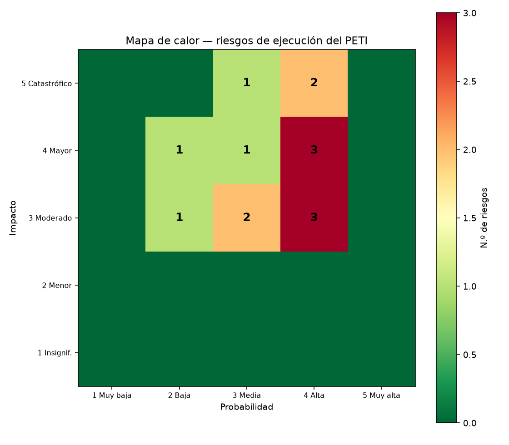

<div align="center">

# UNIVERSIDAD PRIVADA DE TACNA
**FACULTAD DE INGENIERÍA**  
**ESCUELA PROFESIONAL DE INGENIERÍA DE SISTEMAS**

---

## INFORME FINAL DE TALLER — SEMANA 15
### Registro de riesgos del plan y matriz de comunicación

**Asignatura:** SI-886 — Planeamiento Estratégico de TI  
**Docente:** Dr. Oscar Juan Jimenez Flores  
**Organización asignada:** Empresa 03 — Municipalidad Distrital de Alto Selva  
**Equipo:** Grupo 3  

| N.º | Apellidos y Nombres | Código de estudiante | Rol en el taller |
|---|---|---|---|
| 1 | *[Completar integrante 1]* | *[Completar código]* | Coordinador / Contexto y criterios |
| 2 | *[Completar integrante 2]* | *[Completar código]* | Identificación y evaluación (`RG02` / `RG03`) |
| 3 | *[Completar integrante 3]* | *[Completar código]* | Tratamiento y residual (`RG04` / `RG05`) |
| 4 | *[Completar integrante 4]* | *[Completar código]* | Comunicación, Sección 8 y SimpleRisk |

**Tacna — Perú**  
**19 de noviembre de 2026**

</div>

---

> **Nota previa a la entrega en Aula Virtual:** De acuerdo con la guía del taller (`3-TALLER.md`), la entrega oficial se exporta desde `SI886-PLANTILLA-TALLER.docx` a **`SI886-S15-TALLER-Grupo3.pdf`** con la carátula institucional, los códigos reales de todos los integrantes, el índice actualizado y las URLs verificables de la etiqueta `taller-15` en el repositorio. El presente documento Markdown consolida integralmente el desarrollo técnico del taller (Pasos A–G) y el contenido completo requerido por la plantilla.

---

## Índice de contenido

1. [Información sobre el evento práctico](#1-información-sobre-el-evento-práctico)
2. [Diagnóstico de insumos de la organización (Empresa 03)](#2-diagnóstico-de-insumos-de-la-organización-empresa-03)
3. [Desarrollo metodológico (Pasos A hasta E y validación)](#3-desarrollo-metodológico-pasos-a-hasta-e-y-validación)
   - [Paso A — Contexto y criterios](#paso-a--contexto-y-criterios)
   - [Paso B — Identificación sobre las nueve categorías y evaluación](#paso-b--identificación-sobre-las-nueve-categorías-y-evaluación)
   - [Paso C — Tratamiento, señal temprana, riesgo residual y SimpleRisk](#paso-c--tratamiento-señal-temprana-riesgo-residual-y-simplerisk)
   - [Paso D — Matriz de comunicación del riesgo](#paso-d--matriz-de-comunicación-del-riesgo)
   - [Paso E — Redacción de la Sección 8 del PETI](#paso-e--redacción-de-la-sección-8-del-peti)
   - [Paso F y Paso G — Validación, problemas y mejoras, y cierre](#paso-f-y-paso-g--validación-problemas-y-mejoras-y-cierre)
4. [Resultados y evidencias](#4-resultados-y-evidencias)
5. [Conclusiones](#5-conclusiones)
6. [Referencias bibliográficas](#6-referencias-bibliográficas)
7. [Anexos](#7-anexos)

---

## 1. Información sobre el evento práctico

### 1.1 Objetivos

- Definir el **contexto y los criterios** de riesgo del Plan Estratégico de Tecnologías de Información (PETI Año 1 – Año 3) de la **Municipalidad Distrital de Alto Selva**, con fecha previa a la evaluación.
- Identificar riesgos sobre **las nueve categorías obligatorias** (`Presupuestal`, `Patrocinio`, `Capacidad de ejecución`, `Personal clave`, `Resistencia al cambio`, `Proveedor`, `Técnico`, `Normativo`, `De alcance`), incorporando además el riesgo característico de `Ejecución del plan`.
- Evaluar cada riesgo (`Valor = Probabilidad × Impacto`) con escalas operativas definidas y justificadas con datos reales de la entidad.
- Determinar el **tratamiento**, **señal temprana**, **umbral de alerta** y **riesgo residual** de todo riesgo con valor `> 6`.
- Construir la **matriz de comunicación del riesgo** y redactar la **Sección 8 del PETI** conforme a **ISO 31000:2018**, **ISO/IEC 27005:2022** y **COBIT 2019 (APO12 / EDM03)**.

### 1.2 Tecnología aplicada

| Tecnología | Aplicación en el taller | Evidencia generada |
|---|---|---|
| **Python 3.12 (`pandas`, `numpy`)** | Cálculo de valoración `P × I`, verificación de 9 categorías, cálculo de riesgo residual y detección de riesgos sin señal temprana | [`08_riesgos/RG03_evaluado.csv`](08_riesgos/RG03_evaluado.csv), [`evidencias/S15/salidas/RG03_evaluacion.txt`](evidencias/S15/salidas/RG03_evaluacion.txt), [`evidencias/S15/salidas/RG05_residual.txt`](evidencias/S15/salidas/RG05_residual.txt) |
| **Matplotlib** | Generación del mapa de calor `5 × 5` de riesgos del PETI | [`graficos/RG_mapa_calor.png`](graficos/RG_mapa_calor.png) |
| **Docker (SimpleRisk + MariaDB)** | Despliegue de herramienta de gestión de riesgos para registro de escalas, criterio de aceptación y riesgos `≥ 12` | Procedimiento documentado en Paso C y observaciones en Paso F |
| **Git** | Trazabilidad cronológica que acredita que `RG01_contexto.md` fue fijado antes de evaluar y versionamiento con etiquetas `v0.15` y `taller-15` | `git log` y etiquetas locales (`v0.15`, `taller-15`) |

---

## 2. Diagnóstico de insumos de la organización (Empresa 03)

El análisis partió de los tres documentos base entregados para la **Municipalidad Distrital de Alto Selva** en [`EMPRESA-03-municipalidad-alto-selva/`](EMPRESA-03-municipalidad-alto-selva/), contrastando lo que la entidad declara hacer frente a su práctica real:

### 2.1 Política de respaldo (`politica-de-respaldo.md` — `POL-TI-007` v1.0)

- **Desactualización documental:** Aprobada el **21 de julio de 2023** por Gerencia de Administración y Finanzas, con revisión programada para el **22 de agosto de 2024**; a la fecha **no ha sido revisada**. Su difusión se limitó a *«Se envió por correo»*.
- **Incumplimiento de custodia externa y cifrado (puntos 3.3 y 3.6):** La política exige copia fuera de sede y medios cifrados; en la práctica, *«el jefe de sistemas se lleva un disco los viernes»* y **ese disco no está cifrado**. Respecto al respaldo en nube, la entidad asume que está cifrado *«según el proveedor»*, sin verificación propia.
- **Ausencia de pruebas de restauración y registro (puntos 3.4 y 3.7):** No se ejecutan pruebas trimestrales (*«No se ha hecho. Se asume que el respaldo funciona porque termina sin error»*) ni existe registro de restauraciones.
- **Sin Plan de Continuidad del Negocio (BCP):** Confirmado expresamente como *«No»* en la sección 6.

### 2.2 Incoherencias detectadas en el Análisis de Impacto al Negocio (`bia.csv`)

El BIA fue elaborado por un practicante en **setiembre de 2024**, **no fue revisado ni aprobado** y nadie validó sus RTO/RPO con las áreas usuarias. Presenta anomalías críticas en sus 6 procesos:

| ID | Proceso | Criticidad | RTO (h) | RPO (h) | Sistema | Impacto 24 h | Última prueba | Incoherencia detectada |
|---|---|---|---|---|---|---|---|---|
| `BIA01` | Trámite documentario y mesa de partes | Alta | 72 | **96** | Trámite documentario | **Bajo** | 2025-07-08 | **RPO (96 h) > RTO (72 h):** acepta perder 4 días de datos tras caer 3 días; además, tiene criticidad Alta pero impacto a 24 h Bajo. |
| `BIA02` | Recaudación de tributos municipales | Alta | 72 | 48 | Rentas y catastro | Medio | 2025-07-24 | Criticidad Alta de recaudación con tolerancia de 3 días caído y 2 días de pérdida de registros tributarios. |
| `BIA03` | Licencias de funcionamiento y edificación | **Baja** | **4** | **8** | Rentas y catastro | Medio | 2025-04-01 | Criticidad Baja con RTO de 4 h (18× más estricto que `BIA02`) **sobre el mismo sistema** `Rentas y catastro`. |
| `BIA04` | Registro civil | Media | 8 | 48 | **Ninguno** | **Alto** | 2025-04-07 | Mayor impacto a 24 h (Alto) pero **sin sistema de soporte**; aun así reporta RPO 48 h y fecha de prueba. |
| `BIA05` | Contrataciones y logística | **Baja** | **2** | 8 | SIAF-SP | Medio | 2025-04-05 | Criticidad Baja con el RTO más exigente (2 h) sobre un sistema externo administrado por el MEF. |
| `BIA06` | Atención al ciudadano | Baja | 48 | **1** | Mesa de partes virtual | Bajo | 2025-02-13 | Exige RPO de 1 hora (respaldo casi continuo) incompatible con criticidad Baja y política semanal/diaria. |

Adicionalmente, las fechas de «última prueba» de 2025 registradas en `bia.csv` contradicen la declaración literal de TI de que no se realizan pruebas de restauración.

### 2.3 Universo auditable y registro histórico (`universo-auditable-y-riesgos.md`)

- **Cobertura nula de auditoría:** De **17 entidades auditables**, **16 figuran como «Nunca» auditadas** (solo `UA-11` fue auditada en 2023). La capacidad nominal es de **838 horas-auditor/año**, pero la carga real nunca se ha calculado y existen obligaciones ante **PCM-SGTD**.
- **Desalineamiento de inventario (`UA-07` a `UA-11`):** Los sistemas en el universo auditable están cruzados respecto al proceso real que soportan en el BIA (`SIAF-SP` asignado a Trámite; `Trámite documentario` a Recaudación; `Rentas y catastro` a Licencias; `Portal de transparencia estándar` a Registro civil; `Mesa de partes virtual` a Contrataciones).
- **Registro de riesgos inactivo (9 riesgos de Administración, nov-2025):** Todos permanecen **Abiertos** o **En revisión**; 5 están *«Sin definir»*, 3 en *«Mitigar — sin plan»* y `RG-04` (*Interrupción prolongada del sistema principal*) figura **«Aceptado»** sin BCP ni respaldo probado. No existe escala escrita ni apetito de riesgo.

### 2.4 Portafolio PETI de referencia para la trazabilidad

Para trazar cada riesgo a objetivos estratégicos (`OD`) y proyectos (`PR`) de la Municipalidad Distrital de Alto Selva, se utiliza la siguiente estructura de portafolio alineada al diagnóstico institucional:

- **Objetivos:** `OD-01` Modernización de atención y trámite ciudadano · `OD-02` Fortalecimiento de recaudación, catastro y licencias · `OD-03` Continuidad operativa y seguridad de infraestructura TI · `OD-04` Cumplimiento PCM-SGTD, LPDP y control interno · `OD-05` Gobierno de TI, arquitectura y gestión de proveedores/conocimiento.
- **Proyectos:** `PR-01` Trámite y Mesa de Partes Virtual · `PR-02` Modernización y documentación de Rentas y Catastro · `PR-03` Sistematización de Registro Civil · `PR-04` Programa BCP, validación BIA y respaldos cifrados · `PR-05` Gestión de Datos Personales (ANPD) · `PR-06` Adecuación PCM-SGTD y Portal de Transparencia · `PR-07` Control de accesos y segregación en SIAF-SP/Logística · `PR-08` Gestión contractual de proveedores y código fuente · `PR-09` Gestión del conocimiento e inventario TI · `PR-10` Comité de Gobierno Digital y Plan de Auditoría TI.

---

## 3. Desarrollo metodológico (Pasos A hasta E y validación)

### Paso A — Contexto y criterios

**Archivo versionado:** [`08_riesgos/RG01_contexto.md`](08_riesgos/RG01_contexto.md)

| Campo | Definición acordada para la Municipalidad Distrital de Alto Selva |
|---|---|
| **Alcance del análisis** | Riesgos que amenazan la **ejecución del PETI Año 1 – Año 3** (`OD-01`–`OD-05`, `PR-01`–`PR-10`). Excluye incidentes operativos cotidianos de soporte y riesgos institucionales generales del PEI ajenos a TI. |
| **Horizonte** | 3 años (Olas 1 a 3). |
| **Criterio de aceptación** | **≤ 6 (Bajo):** Aceptable con documentación.<br>**7 – 14 (Medio y Alto):** Requiere tratamiento con responsable por cargo, plazo y señal temprana.<br>**≥ 15 (Crítico):** Requiere decisión de la **Gerencia Municipal** antes de aprobar el PETI (y firma de aceptación si el residual es > 6). |
| **Frecuencia de revisión** | Trimestral en el Comité de Gobierno Digital, y extraordinaria ante activación de umbrales, cambios directivos o modificación del PIM > 10 %. |
| **Evidencia de precedencia en Git** | Commit `c2ab4b0` (*"S15 Paso A: define contexto, escalas operativas y criterio de aceptacion antes de evaluar"*) registrado en `git log` antes de la evaluación de riesgos. |

**Escalas operativas resumidas (Matriz `5 × 5`):**
- **Probabilidad (`P`):** `1 Muy baja` (< 10 %), `2 Baja` (10–25 %), `3 Media` (26–50 %), `4 Alta` (51–80 %, condiciones causales ya presentes en la municipalidad), `5 Muy alta` (> 80 %).
- **Impacto (`I`):** `1 Insignificante`, `2 Menor`, `3 Moderado` (retraso 1–3 meses / caída 4–24 h / sobrecosto 6–15 %), `4 Mayor` (retraso > 3 meses / caída 24–72 h / sanción PCM-SGTD o ANPD), `5 Catastrófico` (fracaso del PETI / caída > 72 h / recorte > 30 %).

---

### Paso B — Identificación sobre las nueve categorías y evaluación

**Archivos generados:** [`08_riesgos/RG02_registro.csv`](08_riesgos/RG02_registro.csv), [`08_riesgos/RG03_evaluacion.py`](08_riesgos/RG03_evaluacion.py), [`08_riesgos/RG03_evaluado.csv`](08_riesgos/RG03_evaluado.csv), [`graficos/RG_mapa_calor.png`](graficos/RG_mapa_calor.png)

Se identificaron **14 riesgos (`R-01` a `R-14`)** redactados como **evento + causa + consecuencia** (los riesgos de `Patrocinio` y `Personal clave` redactados estrictamente por **cargo**), cubriendo **las 9 categorías** sin omisiones (`Categorías SIN riesgo identificado: ninguna ✔`):

| ID | Categoría | Riesgo (evento + causa + consecuencia) | Trazabilidad (OD / PR) | Origen | P | I | Valor | Nivel |
|---|---|---|---|---|---|---|---|---|
| `R-01` | Ejecución del plan | Que el PETI se apruebe y no se ejecute por ausencia de responsable designado y seguimiento periódico, paralizando su cumplimiento al año 3 | OD-01..OD-05 · PR-01..PR-10 | Riesgo característico · `universo-auditable` | 4 | 5 | **20** | **Crítico** |
| `R-02` | Técnico | Que una falla severa o ransomware comprometa Rentas y Trámite por falta de pruebas de restauración, disco externo sin cifrar y ausencia de BCP, paralizando servicios > 72 h con pérdida de hasta 96 h de datos | OD-01, OD-02, OD-03 · PR-04 | `politica-de-respaldo` · `bia.csv` · RG-04, RG-05, UA-13 | 4 | 5 | **20** | **Crítico** |
| `R-03` | Normativo | Que la municipalidad reciba sanciones de PCM-SGTD, Contraloría o ANPD por incumplir Gobierno Digital y carecer de registro de datos personales y auditorías (`UA-17`), deteniendo despliegues | OD-04 · PR-05, PR-06 | `universo-auditable` (UA-17, RG-01, RG-03, RG-06, RG-07) | 4 | 4 | **16** | **Crítico** |
| `R-04` | Proveedor | Que la interrupción o término del único proveedor de soporte/nube bloquee Rentas y Catastro por falta de código fuente documentado y SLA/cifrado no verificados | OD-02, OD-05 · PR-02, PR-08 | `universo-auditable` (UA-15, UA-16, RG-02, RG-08) | 4 | 4 | **16** | **Crítico** |
| `R-06` | Presupuestal | Que el PIM asignado al PETI en el año 2 se recorte o reasigne a gasto corriente ante caída de recaudación o falta de expedientes, retrasando PR-04 y PR-03 | OD-01, OD-02, OD-03 · PR-02, PR-03, PR-04 | Pre-mortem · `bia.csv` · `politica-de-respaldo` | 4 | 4 | **16** | **Crítico** |
| `R-05` | Patrocinio | Que un cambio de gestión o rotación en Gerencia Municipal/Administración retire el respaldo ejecutivo al PETI por no existir Comité de Gobierno Digital ni apetito de riesgo formal | OD-01..OD-05 · PR-01..PR-10 | Pre-mortem · `politica-de-respaldo` · `universo-auditable` | 3 | 5 | **15** | **Crítico** |
| `R-07` | Técnico | Que PR-01, PR-02, PR-04 y PR-09 fallen en su dimensionamiento por sustentarse en un BIA no validado con 6 incoherencias severas y un inventario `UA-07..UA-11` desalineado | OD-01, OD-02, OD-03, OD-05 · PR-01..PR-04, PR-09 | `bia.csv` (BIA01–BIA06) · `universo-auditable` | 4 | 3 | **12** | **Alto** |
| `R-08` | Personal clave | Que la ausencia prolongada del Jefe de TI paralice respaldos y Ola 1 al concentrar ejecución, verificación, custodia física del disco y conocimiento sin código fuente | OD-03, OD-05 · PR-04, PR-09 | `politica-de-respaldo` (Sec. 4 y 6) · RG-02 | 4 | 3 | **12** | **Alto** |
| `R-09` | Capacidad de ejecución | Que Auditoría Interna y TI no cubran las verificaciones del PETI en paralelo a la operación diaria porque las 838 h-auditor/año no bastan para las 17 entidades acumuladas | OD-04, OD-05 · PR-07, PR-10 | `universo-auditable` (Sec. 2 y 4) | 4 | 3 | **12** | **Alto** |
| `R-10` | Resistencia al cambio | Que el personal de áreas usuarias mantenga registros en papel o archivos locales por difusión pasiva («se envió por correo») y falta de involucramiento | OD-01, OD-02 · PR-01, PR-03, PR-07 | `politica-de-respaldo` · `bia.csv` (BIA04) | 3 | 4 | **12** | **Alto** |
| `R-11` | De alcance | Que las áreas usuarias pidan módulos ad hoc sin caso de negocio ni filtro del Comité de TI, desplazando las entregas de Ola 1 y Ola 2 | OD-01, OD-02, OD-05 · PR-01..PR-10 | Pre-mortem · `universo-auditable` | 3 | 3 | **9** | **Medio** |
| `R-13` | Presupuestal | Que el OPEX acumulado en nube, enlaces (`UA-12`) y soporte supere el presupuesto del año 3 por falta de auditoría contractual, obligando a recortar servicios | OD-01, OD-03 · PR-01, PR-04, PR-08 | Pre-mortem · `universo-auditable` (UA-12, UA-16) | 3 | 3 | **9** | **Medio** |
| `R-12` | Normativo | Que se produzca fraude interno en compras y pagos (`SIAF-SP`) por falta de segregación de funciones y auditoría en `UA-05` y `UA-14` | OD-04 · PR-07 | `universo-auditable` (UA-05, UA-07, UA-14, RG-09) | 2 | 4 | **8** | **Medio** |
| `R-14` | Resistencia al cambio | Que la comunicación solo por correo de directivas de respaldo no erradique el guardado local en PC, generando pérdidas menores no críticas | OD-03 · PR-04 | `politica-de-respaldo` (Ficha y Sec. 4) | 2 | 3 | **6** | **Bajo** |

**Resultado de la ejecución de `RG03_evaluacion.py`:**
- **Distribución:** `6 Críticos` (42.9 %), `4 Altos` (28.6 %), `3 Medios` (21.4 %), `1 Bajo` (7.1 %).
- **Riesgos ≥ 15 que requieren decisión expresa de la Gerencia Municipal antes de aprobar el PETI:** `R-01` (20), `R-02` (20), `R-03` (16), `R-04` (16), `R-06` (16), `R-05` (15).



*Figura 1. Mapa de calor de los riesgos de ejecución del PETI de la Municipalidad Distrital de Alto Selva (matriz 5 × 5 generada con `RG03_evaluacion.py`). Se observa la concentración de 10 riesgos en zona alta y crítica (`P ≥ 3`, `I ≥ 3`), con foco máximo en `R-01` y `R-02` (`P=4, I=5`).*

---

### Paso C — Tratamiento, señal temprana, riesgo residual y SimpleRisk

**Archivos generados:** [`08_riesgos/RG04_tratamiento.csv`](08_riesgos/RG04_tratamiento.csv), [`08_riesgos/RG05_residual.py`](08_riesgos/RG05_residual.py), [`evidencias/S15/salidas/RG05_residual.txt`](evidencias/S15/salidas/RG05_residual.txt)

Los **13 riesgos con valor > 6** (`R-01` a `R-13`) cuentan con decisión de tratamiento, acciones concretas, responsable por cargo, plazo, costo, riesgo residual, señal temprana observable y umbral de alerta (`R-14 = 6` se acepta con documentación):

| ID | Valor | Decisión | Acciones principales | Responsable (cargo) | Plazo | Costo | P res. | I res. | Residual | Señal temprana | Umbral de alerta | Acepta residual |
|---|---|---|---|---|---|---|---|---|---|---|---|---|
| `R-01` | 20 | Mitigar | Designar por resolución al Líder de Gobierno Digital; reactivar Comité con seguimiento de los 9 riesgos abiertos | Gerencia Municipal | Al aprobar el plan | Bajo | 2 | 4 | **8** | Comité sin sesionar ni levantar acta | 1 trimestre sin sesión formal | Gerencia Municipal |
| `R-02` | 20 | Mitigar | Actualizar POL-TI-007; respaldo nube cifrado e inmutable; pruebas trimestrales con acta; aprobar BCP | Jefatura de TI | 60 días | Medio | 2 | 4 | **8** | Prueba trimestral vencida o respaldo sin cifrado | 1 trimestre sin acta verificada | Gerencia Municipal |
| `R-03` | 16 | Mitigar | Registro de bancos de datos ante ANPD (`PR-05`); plan PCM-SGTD (`PR-06`); auditar `UA-17` | Oficial de Datos Personales / Asesoría Jurídica | 90 días | Medio | 2 | 4 | **8** | Requerimiento de PCM-SGTD o ANPD | 1 requerimiento sin respuesta o retraso > 15 d | Gerencia Municipal |
| `R-04` | 16 | Transferir + Mitigar | Renegociar contratos (Rentas, `UA-16`) exigiendo SLA, verificación de cifrado, código fuente y plan de salida | Gerencia de Administración y Finanzas | Antes de PR-02 | Medio | 2 | 4 | **8** | Contrato sin cláusula de código fuente o SLA | A 60 días de PR-02 sin adenda firmada | Gerencia Municipal |
| `R-06` | 16 | Mitigar + Asumir c/ contingencia | Aprobación multianual en PIA/PIM; hitos por ola y cartera mínima contingente (`PR-04`, `PR-02`) | Gerencia de Administración / Planeamiento | Al aprobar el plan | Bajo | 3 | 3 | **9** | Caída en recaudación o demora en certificación | Desviación > 10 % PIM o 30 d sin certificar | Gerencia Municipal |
| `R-05` | 15 | Mitigar | Institucionalizar patrocinio en Comité de Gobierno Digital, apetito de riesgo formal e inducción directiva | Gerencia Municipal | Al aprobar el plan | Bajo | 2 | 4 | **8** | Inasistencia de Gerencia Municipal/Adm. al comité | 2 sesiones consecutivas sin alta dirección | Gerencia Municipal |
| `R-07` | 12 | Mitigar | Reelaborar y validar BIA con áreas usuarias; conciliar inventario `UA-07..UA-11` antes de Ola 1 | Jefatura de TI / Gerencias usuarias | 30 días | Bajo | 1 | 3 | **3** | Inconsistencias abiertas BIA vs universo | 1 semana de retraso sobre hito de validación | Comité de Gobierno Digital |
| `R-08` | 12 | Mitigar | Segregar ejecución/verificación/custodia de respaldos; documentar código y formar 2.º especialista TI | Jefatura de TI / RR. HH. | 90 días | Medio | 2 | 3 | **6** | Una sola persona concentrando accesos/respaldo | Factor bus = 1 en sistema crítico | Jefatura de TI / Administración |
| `R-09` | 12 | Mitigar | Plan Anual de Auditoría TI basado en riesgo sobre las 838 h-auditor (`UA-13`, `UA-14`, `UA-17`, `UA-05`, `UA-09`) | Jefatura de Auditoría Interna | 45 días | Bajo | 2 | 4 | **8** | Desviación en ejecución de horas-auditor | Avance trimestral < 75 % de horas planificadas | Gerencia Municipal |
| `R-10` | 12 | Mitigar | Facilitadores funcionales por gerencia; talleres prácticos de adopción y levantamiento con Registro Civil | Gerencia de Administración / Áreas usuarias | Antes de piloto PR-01/PR-03 | Bajo | 2 | 3 | **6** | Baja asistencia o uso de cuadernos paralelos | Participación < 70 % o > 20 % fuera de sistema | Gerencia de Administración |
| `R-11` | 9 | Mitigar | Regla de admisión única: todo pedido requiere caso de negocio y aprobación del Comité | Comité de Gobierno Digital | Continuo | Bajo | 2 | 3 | **6** | Pedidos directos a TI sin ticket de comité | 1 requerimiento atendido sin aprobación | Comité de Gobierno Digital |
| `R-13` | 9 | Mitigar + Transferir | Auditar consumos/contratos nube (`UA-16`) y enlaces (`UA-12`); fijar topes de OPEX a 3 años | Gerencia de Administración / TI | Antes de Ola 2 | Bajo | 2 | 3 | **6** | Incremento no previsto en facturación mensual | Desviación > 10 % mensual sobre OPEX | Gerencia de Administración |
| `R-12` | 8 | Mitigar | Auditar `UA-05` y `UA-14`; implementar matriz de segregación de funciones (SoD) en `SIAF-SP` | Auditoría Interna / Jefatura de TI | 90 días | Bajo | 1 | 4 | **4** | Perfiles incompatibles o cuentas huérfanas | 1 usuario conflictivo sin corregir en 48 h | Gerencia de Administración |

**Resultados de `RG05_residual.py`:**
- **Valor agregado del plan de tratamiento:** Reducción de **177 puntos iniciales a 88 puntos residuales** = **`89 puntos` reducidos (`50 %` de reducción)**.
- **Riesgos residuales por encima del criterio (`> 6`):** **7 riesgos** (`R-01`, `R-02`, `R-03`, `R-04`, `R-06`, `R-05`, `R-09`). Todos requieren **aceptación formal firmada por la Gerencia Municipal** antes de aprobar el PETI.
- **Riesgos sin señal temprana:** **`0` (`[]`)**.

**Configuración y carga en SimpleRisk (Docker):**  
Comandos de despliegue definidos en la guía para registrar los **10 riesgos con valor `≥ 12`** (`R-01` a `R-10`) usando fórmula clásica (`Probabilidad × Impacto`), escalas operativas escritas y criterio de aceptación:
```bash
docker run -d --name peti_srdb -e MARIADB_ROOT_PASSWORD=peti_sr \
  -e MARIADB_DATABASE=simplerisk mariadb:11
docker run -d --name peti_simplerisk --link peti_srdb:db \
  -p 127.0.0.1:8084:80 simplerisk/simplerisk:latest
```
*(Ver estado de ejecución local de Docker en la subsección de Problemas y mejoras).*

---

### Paso D — Matriz de comunicación del riesgo

**Archivo generado:** [`08_riesgos/RG06_comunicacion.csv`](08_riesgos/RG06_comunicacion.csv)

| ID | Qué se comunica | A quién (cargo) | Cuándo / frecuencia | Canal | Quién comunica | Formato | Qué decisión habilita |
|---|---|---|---|---|---|---|---|
| `R-01` | Estado de ejecución del PETI, sesiones del Comité y cierre de los 9 riesgos abiertos | Gerencia Municipal y Comité de Gobierno Digital | Trimestral | Sesión de comité | Líder de Gobierno Digital | Tablero de control + acta | Continuar ola, ajustar cronograma o escalar bloqueos |
| `R-02` | Resultados de pruebas de restauración, estado de cifrado y avance del BCP | Gerencia Municipal y Gerencia de Administración | Trimestral (y alerta inmediata ante falla) | Informe técnico y comité | Jefatura de TI | Acta de prueba + estado POL-TI-007 | Validar continuidad o activar contingencia |
| `R-03` | Adecuación PCM-SGTD, registro ANPD y auditoría `UA-17` | Gerencia Municipal y Comité de Gobierno Digital | Mensual (90 d); luego trimestral | Informe escrito + comité | Oficial de Datos Personales / Asesoría Jurídica | Matriz normativa (1 pág.) | Priorizar remediación o detener despliegues expuestos |
| `R-04` | Estado de renegociación contractual, verificación de cifrado nube y código fuente | Gerencia Municipal | Quincenal hasta firma | Correo ejecutivo y revisión | Gerencia de Administración y Finanzas | Ficha en 1 línea + semáforo | Renovar con SLA o activar plan de salida |
| `R-06` | Ejecución presupuestal vs. PIA/PIM municipal y proyección Ola 2–3 | Gerencia Municipal y Planeamiento | Trimestral y si desviación > 10 % | Informe escrito | Gerencia de Administración y Finanzas | Reporte financiero (1 pág.) | Modificación presupuestal o cartera contingente |
| `R-05` | Participación directiva en el Comité y vigencia del apetito de riesgo | Gerencia Municipal y Alcaldía | Trimestral (alerta tras 1 ausencia) | Sesión formal / Memorando | Presidente del Comité | Acta de asistencia | Reconfirmar patrocinio y prioridad del PETI |
| `R-07` | Cierre de inconsistencias del BIA y conciliación `UA-07..UA-11` | Comité de Gobierno Digital y Gerencias usuarias | Semanal durante 30 días | Sesión técnica | Jefatura de TI | Matriz BIA validada + acta | Aprobar alcance técnico de PR-01, PR-02 y PR-04 |
| `R-08` | Documentación técnica, segregación de respaldos y cobertura de 2.º especialista | Gerencia de Administración y RR. HH. | Mensual mientras residual/factor bus sea crítico | Correo con tablero | Jefatura de TI | Indicador de cobertura | Aprobar capacitación o contratación |
| `R-09` | Ejecución del Plan de Auditoría TI sobre las 838 h-auditor/año | Gerencia Municipal y Auditoría Interna | Trimestral | Sesión de comité e informe | Jefatura de Auditoría Interna | Tablero de horas y hallazgos | Reasignar horas o priorizar entidades críticas |
| `R-10` | Participación en talleres y % de trámites registrados vs. papel | Gerencia de Administración y Gerencias usuarias | Quincenal durante pilotos | Reunión operativa | Facilitadores funcionales / TI | Tablero de adopción | Reforzar capacitación o ajustar flujos |
| **Todos ≥ 15** | **Riesgo crítico, tratamiento, valor residual (> 6) y responsable de aceptación** | **Gerencia Municipal** | **Antes de aprobar el PETI** | **Sesión formal de aprobación** | **Responsable del plan / Líder GD** | **Anexo Sección 9 del PETI con firmas** | **Aprobar el PETI asumiendo con conocimiento el riesgo residual** |

---

### Paso E — Redacción de la Sección 8 del PETI

La redacción completa de la **Sección 8. Gestión de riesgos del plan** (subsecciones `8.1` a `8.9`) para el PETI de la **Municipalidad Distrital de Alto Selva** se ha generado y versionado en [`08_riesgos/seccion_08_gestion_riesgos.md`](08_riesgos/seccion_08_gestion_riesgos.md), integrando:

- **8.1 Alcance, contexto y criterios:** Cobertura PETI Año 1–3, escalas operativas `5 × 5`, umbrales de aceptación (`≤ 6`, `7–14`, `≥ 15`) y fecha previa de acuerdo (`19-nov-2026`).
- **8.2 Método:** ISO 31000:2018, ISO/IEC 27005:2022, COBIT 2019 (`APO12`, `EDM03`), contraste documental (`POL-TI-007`, `bia.csv`, `universo-auditable-y-riesgos.md`) y pre-mortem.
- **8.3 Registro de riesgos:** Tabla integral con los 14 riesgos y declaración expresa de **cero categorías omitidas**.
- **8.4 Evaluación y mapa de calor:** Distribución (`6 Críticos`, `4 Altos`, `3 Medios`, `1 Bajo`), identificación de los 6 riesgos `≥ 15` para decisión de Gerencia Municipal y enlace a `RG_mapa_calor.png`.
- **8.5 Tratamiento y riesgo residual:** Plan para los 13 riesgos `> 6` con reducción de **89 puntos (50 %)**.
- **8.6 Señales tempranas y umbrales de alerta:** 13 señales observables y umbrales cuantificables (`0` riesgos sin señal).
- **8.7 Matriz de comunicación del riesgo:** Referencia a `RG06_comunicacion.csv` (8 columnas).
- **8.8 Riesgos residuales que requieren aceptación formal:** Listado de los 7 riesgos residuales `> 6` (`R-01`, `R-02`, `R-03`, `R-04`, `R-06`, `R-05`, `R-09`) vinculados al Anexo de firmas de la Sección 9.
- **8.9 Seguimiento y revisión:** Periodicidad trimestral, responsables y 5 disparadores de revisión extraordinaria.

---

### Paso F y Paso G — Validación, problemas y mejoras, y cierre

#### Validación ejecutada (`evidencias/S15/salidas/validacion.txt`)

| Comprobación | Resultado obtenido | Estado |
|---|---|---|
| **1. Cobertura de las 9 categorías** | `Ninguna categoría faltante (9/9 cubiertas)` + `Ejecución del plan` | **Aprobado** |
| **2. Justificación de P e I con datos** | `0 riesgos sin justificación con dato` (`14/14` fundamentados con métricas y hallazgos de Alto Selva) | **Aprobado** |
| **3. Tratamiento, responsable por cargo, señal temprana y aceptación** | `0 riesgos > 6 sin tratamiento` · `0 sin responsable` · `0 sin señal temprana` · `0 residuales > 6 sin responsable de aceptación` | **Aprobado** |

#### Problemas y mejoras (documentación transparente de brechas pendientes)

1. **SimpleRisk en Docker:** Al verificar el entorno (`docker info` en Windows), el cliente Docker CLI (`v28.4.0`) está instalado, pero el servicio de **Docker Desktop no se encontraba en ejecución**, por lo que no se levantaron los contenedores `peti_srdb` y `peti_simplerisk` ni se tomaron capturas reales de la interfaz web. *Acción de mejora:* iniciar Docker Desktop, ejecutar los dos comandos `docker run` del Paso C, cargar los 10 riesgos `≥ 12` en `http://127.0.0.1:8084` y guardar las capturas en `evidencias/S15/`.
2. **Firmas reales y datos de carátula:** El Anexo de aceptación formal de los 7 riesgos residuales (`> 6`) queda redactado en el Anexo A para firma de la Gerencia Municipal; asimismo, en la carátula se deben completar los nombres y códigos de los integrantes del Grupo 3 antes de exportar a PDF desde `SI886-PLANTILLA-TALLER.docx`.

#### Pregunta de transferencia (Paso G)

> Si una municipalidad real aprobara su PETI omitiendo escalas previas, señales tempranas y aceptación formal de riesgos residuales, **asumiría compromisos tecnológicos y presupuestales inviables sobre un BIA inconsistente y respaldos no probados, exponiéndose a paralizaciones prolongadas de recaudación y trámite ciudadano sin capacidad de recuperación**. Asimismo, **ningún funcionario asumiría responsabilidad sobre los riesgos críticos latentes (`R-01` a `R-06`), convirtiendo al PETI en un documento formal sin ejecución ni defensa ante observaciones de Contraloría, PCM-SGTD o ANPD**.

---

## 4. Resultados y evidencias

### 4.1 Los tres resultados calificados (Sección 3.1 de la guía)

| Resultado | Qué demuestra | Evidencia local y enlace en repositorio (`taller-15`) |
|---|---|---|
| **El registro completo** | 9 categorías cubiertas sin omisiones, criterios fijados antes de evaluar (`c2ab4b0`) y 14 riesgos `evento + causa + consecuencia` | [`08_riesgos/RG01_contexto.md`](08_riesgos/RG01_contexto.md) · [`08_riesgos/RG02_registro.csv`](08_riesgos/RG02_registro.csv) |
| **La valoración fundamentada** | P e I justificados con cifras reales de `POL-TI-007`, `bia.csv` y `universo-auditable-y-riesgos.md`, más mapa de calor | [`08_riesgos/RG03_evaluado.csv`](08_riesgos/RG03_evaluado.csv) · [`graficos/RG_mapa_calor.png`](graficos/RG_mapa_calor.png) |
| **El tratamiento** | 13 riesgos `> 6` con acciones, cargo responsable, señal temprana (`0` sin señal), reducción del 50 % y 7 residuales para firma | [`08_riesgos/RG04_tratamiento.csv`](08_riesgos/RG04_tratamiento.csv) · [`08_riesgos/seccion_08_gestion_riesgos.md`](08_riesgos/seccion_08_gestion_riesgos.md) |

### 4.2 Lista de comprobación del taller (Sección 3.2 — 14 resultados)

*(Las URLs apuntan a la etiqueta `taller-15` en `https://github.com/FabricioRams/SI886-S15-TALLER-Grupo3/tree/taller-15`).*

| # | Resultado esperado | Evidencia local verificada | URL en GitHub (`taller-15`) / Estado |
|---|---|---|---|
| 1 | Contexto y criterios definidos, con fecha de acuerdo anterior a la evaluación | [`08_riesgos/RG01_contexto.md`](08_riesgos/RG01_contexto.md) + commit `c2ab4b0` | https://github.com/FabricioRams/SI886-S15-TALLER-Grupo3/blob/taller-15/08_riesgos/RG01_contexto.md |
| 2 | Escalas de probabilidad e impacto con definición operativa escrita | [`08_riesgos/RG01_contexto.md`](08_riesgos/RG01_contexto.md) (Sec. 2) | https://github.com/FabricioRams/SI886-S15-TALLER-Grupo3/blob/taller-15/08_riesgos/RG01_contexto.md |
| 3 | Las nueve categorías evaluadas; las omitidas, justificadas | [`evidencias/S15/salidas/RG03_evaluacion.txt`](evidencias/S15/salidas/RG03_evaluacion.txt) (`ninguna ✔`) | https://github.com/FabricioRams/SI886-S15-TALLER-Grupo3/blob/taller-15/evidencias/S15/salidas/RG03_evaluacion.txt |
| 4 | Registro con `≥ 12` riesgos, redactados como evento + causa + consecuencia | [`08_riesgos/RG02_registro.csv`](08_riesgos/RG02_registro.csv) (14 riesgos) | https://github.com/FabricioRams/SI886-S15-TALLER-Grupo3/blob/taller-15/08_riesgos/RG02_registro.csv |
| 5 | Cada riesgo trazado a los objetivos y proyectos que afecta | [`08_riesgos/RG02_registro.csv`](08_riesgos/RG02_registro.csv) (columna `Objetivos o proyectos afectados`) | https://github.com/FabricioRams/SI886-S15-TALLER-Grupo3/blob/taller-15/08_riesgos/RG02_registro.csv |
| 6 | Mapa de calor generado | [`graficos/RG_mapa_calor.png`](graficos/RG_mapa_calor.png) | https://github.com/FabricioRams/SI886-S15-TALLER-Grupo3/blob/taller-15/graficos/RG_mapa_calor.png |
| 7 | Riesgos `≥ 15` identificados como decisión de la gerencia general | [`evidencias/S15/salidas/RG03_evaluacion.txt`](evidencias/S15/salidas/RG03_evaluacion.txt) (6 riesgos: `R-01`..`R-06`) | https://github.com/FabricioRams/SI886-S15-TALLER-Grupo3/blob/taller-15/evidencias/S15/salidas/RG03_evaluacion.txt |
| 8 | Tratamiento definido para todos los riesgos de valor `> 6` | [`08_riesgos/RG04_tratamiento.csv`](08_riesgos/RG04_tratamiento.csv) (13/13 riesgos) | https://github.com/FabricioRams/SI886-S15-TALLER-Grupo3/blob/taller-15/08_riesgos/RG04_tratamiento.csv |
| 9 | Riesgo residual calculado, con la reducción lograda | [`evidencias/S15/salidas/RG05_residual.txt`](evidencias/S15/salidas/RG05_residual.txt) (89 pts / 50 %) | https://github.com/FabricioRams/SI886-S15-TALLER-Grupo3/blob/taller-15/evidencias/S15/salidas/RG05_residual.txt |
| 10 | Señal temprana y umbral de alerta en cada riesgo `> 6`; cero sin señal | [`evidencias/S15/salidas/RG05_residual.txt`](evidencias/S15/salidas/RG05_residual.txt) (`0 → []`) | https://github.com/FabricioRams/SI886-S15-TALLER-Grupo3/blob/taller-15/evidencias/S15/salidas/RG05_residual.txt |
| 11 | Riesgos residuales sobre el criterio con responsable de aceptación identificado | [`evidencias/S15/salidas/RG05_residual.txt`](evidencias/S15/salidas/RG05_residual.txt) (7 riesgos → Gerencia Municipal) | https://github.com/FabricioRams/SI886-S15-TALLER-Grupo3/blob/taller-15/evidencias/S15/salidas/RG05_residual.txt |
| 12 | Registro cargado en SimpleRisk con escalas y criterio configurados | *Pendiente por Docker Desktop detenido en equipo local* | Ver sección *Problemas y mejoras* (pendiente captura en `evidencias/S15/`) |
| 13 | Matriz de comunicación con las ocho columnas | [`08_riesgos/RG06_comunicacion.csv`](08_riesgos/RG06_comunicacion.csv) | https://github.com/FabricioRams/SI886-S15-TALLER-Grupo3/blob/taller-15/08_riesgos/RG06_comunicacion.csv |
| 14 | Sección 8 redactada · etiqueta `v0.15` | [`08_riesgos/seccion_08_gestion_riesgos.md`](08_riesgos/seccion_08_gestion_riesgos.md) + tags `v0.15` / `taller-15` | https://github.com/FabricioRams/SI886-S15-TALLER-Grupo3/blob/taller-15/08_riesgos/seccion_08_gestion_riesgos.md |

---

## 5. Conclusiones

1. El análisis documental de la **Municipalidad Distrital de Alto Selva** evidenció una brecha crítica entre lo declarado y la práctica real: una política de respaldos vencida (`POL-TI-007`), copias externas transportadas en un disco sin cifrar, ausencia total de pruebas de restauración y BCP, un BIA con 6 de 6 procesos inconsistentes elaborado sin validación de áreas, 16 de 17 entidades nunca auditadas y 9 riesgos institucionales abiertos sin plan de tratamiento.
2. Estructurar cada riesgo como **evento + causa + consecuencia** y justificar probabilidad e impacto con datos observables permitió identificar **14 riesgos en las 9 categorías** (`6 Críticos`, `4 Altos`, `3 Medios`, `1 Bajo`), concentrando los mayores puntajes (`20` y `16`) en la falta de gobernanza del PETI (`R-01`), la vulnerabilidad de respaldos/continuidad (`R-02`), el incumplimiento PCM-SGTD/LPDP (`R-03`), la dependencia de proveedor sin código fuente (`R-04`) y el riesgo de recorte del PIM (`R-06`).
3. El plan de tratamiento reduce la exposición agregada en **89 puntos (`50 %`)**, pero deja **7 riesgos residuales por encima del umbral de aceptación (`> 6`)** con señales tempranas y umbrales explícitos; su formalización exige que la **Gerencia Municipal** conozca y firme expresamente esa aceptación residual antes de aprobar el PETI, evitando trasladar dicha responsabilidad al equipo formulador.

---

## 6. Referencias bibliográficas

- ISO 31000:2018. *Risk management — Guidelines*. https://www.iso.org/standard/65694.html
- ISO/IEC 27005:2022. *Guidance on managing information security risks*. https://www.iso.org/standard/80585.html
- IEC 31010:2019. *Risk management — Risk assessment techniques*. https://www.iso.org/standard/72140.html
- ISACA. (2018). *COBIT 2019 Framework: Governance and Management Objectives* (`APO12 Managed Risk`, `EDM03 Ensured Risk Optimization`). https://www.isaca.org/resources/cobit
- Project Management Institute. *Guía de los Fundamentos para la Dirección de Proyectos (Guía del PMBOK)*. https://www.pmi.org/
- Klein, G. (2007). Performing a project premortem. *Harvard Business Review*, 85(9), 18–19.
- Presidencia del Consejo de Ministros — Secretaría de Gobierno Digital. *Resolución de Secretaría de Gobierno Digital N.° 005-2018-PCM/SEGDI, Anexo I — Lineamientos para la formulación del Plan de Gobierno Digital (PGD)*. https://cdn.www.gob.pe/uploads/document/file/356863/Anexo_I_Lineamientos_PGD.pdf
- SimpleRisk. *Documentation*. https://www.simplerisk.com/documentation
- Rodríguez Bermúdez, J. R. (2015). *Planificación y dirección estratégica de sistemas de información*. Editorial UOC.

---

## 7. Anexos

### Anexo A — Formato de aceptación formal de riesgos residuales (Sección 9 del PETI)

En cumplimiento del criterio de aceptación establecido en `RG01_contexto.md`, los siguientes **7 riesgos residuales superiores a 6** se presentan ante la **Gerencia Municipal de la Municipalidad Distrital de Alto Selva** para su aceptación formal previa a la aprobación del PETI:

| ID | Riesgo (resumen) | Valor inicial | Tratamiento resumido | Valor residual | Cargo aceptante | Firma y fecha |
|---|---|---|---|---|---|---|
| `R-01` | No ejecución del PETI por ausencia de responsable y seguimiento | 20 | Designación por resolución y Comité trimestral | **8** | Gerencia Municipal | ___________________ |
| `R-02` | Falla/ransomware sobre respaldos no probados y sin BCP | 20 | Nube cifrada, pruebas trimestrales y BCP | **8** | Gerencia Municipal | ___________________ |
| `R-03` | Sanciones PCM-SGTD / ANPD por incumplimiento normativo | 16 | Registro ANPD, plan PCM-SGTD y auditoría `UA-17` | **8** | Gerencia Municipal | ___________________ |
| `R-04` | Bloqueo por único proveedor sin código fuente ni SLA | 16 | Renegociación con SLA, cifrado y depósito de código | **8** | Gerencia Municipal | ___________________ |
| `R-06` | Recorte o reasignación del PIM asignado al PETI en Año 2 | 16 | Acuerdo multianual PIA/PIM y cartera contingente | **9** | Gerencia Municipal | ___________________ |
| `R-05` | Pérdida de patrocinio ante cambio de gestión o rotación | 15 | Institucionalización en Comité y apetito formal | **8** | Gerencia Municipal | ___________________ |
| `R-09` | Capacidad de auditoría (838 h) insuficiente para 17 entidades | 12 | Plan anual basado en riesgo priorizado | **8** | Gerencia Municipal | ___________________ |

### Anexo B — Inventario de artefactos generados en el repositorio

- [`08_riesgos/RG01_contexto.md`](08_riesgos/RG01_contexto.md) — Contexto, escalas operativas, criterios de aceptación y dueños por cargo.
- [`08_riesgos/RG02_registro.csv`](08_riesgos/RG02_registro.csv) — Registro de 14 riesgos sobre las 9 categorías + Ejecución del plan.
- [`08_riesgos/RG03_evaluacion.py`](08_riesgos/RG03_evaluacion.py) — Script de evaluación cuantitativa y mapa de calor.
- [`08_riesgos/RG03_evaluado.csv`](08_riesgos/RG03_evaluado.csv) — Salida ordenada con valor y nivel de riesgo.
- [`graficos/RG_mapa_calor.png`](graficos/RG_mapa_calor.png) — Mapa de calor `5 × 5`.
- [`08_riesgos/RG04_tratamiento.csv`](08_riesgos/RG04_tratamiento.csv) — Plan de tratamiento, residual, señal temprana y umbral de alerta.
- [`08_riesgos/RG05_residual.py`](08_riesgos/RG05_residual.py) — Script de análisis de reducción residual y validación de señales.
- [`08_riesgos/RG06_comunicacion.csv`](08_riesgos/RG06_comunicacion.csv) — Matriz de comunicación de riesgos (8 columnas).
- [`08_riesgos/seccion_08_gestion_riesgos.md`](08_riesgos/seccion_08_gestion_riesgos.md) — Sección 8 del PETI (`8.1` a `8.9`).
- [`evidencias/S15/salidas/RG03_evaluacion.txt`](evidencias/S15/salidas/RG03_evaluacion.txt), [`evidencias/S15/salidas/RG05_residual.txt`](evidencias/S15/salidas/RG05_residual.txt), [`evidencias/S15/salidas/validacion.txt`](evidencias/S15/salidas/validacion.txt) — Salidas de ejecución y validación.
